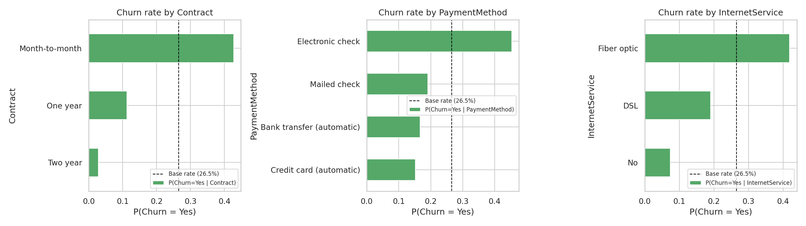
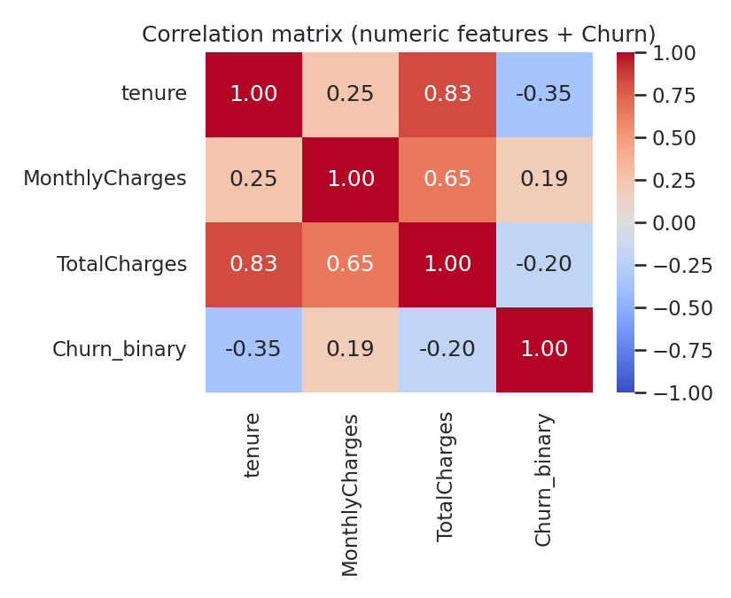
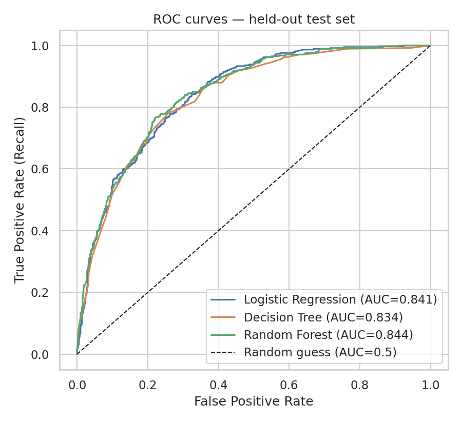
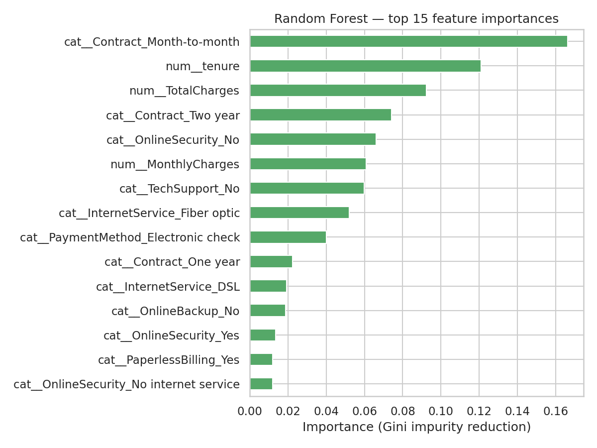
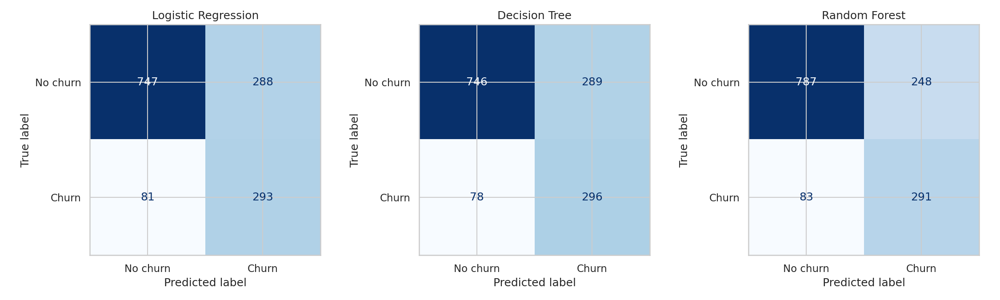
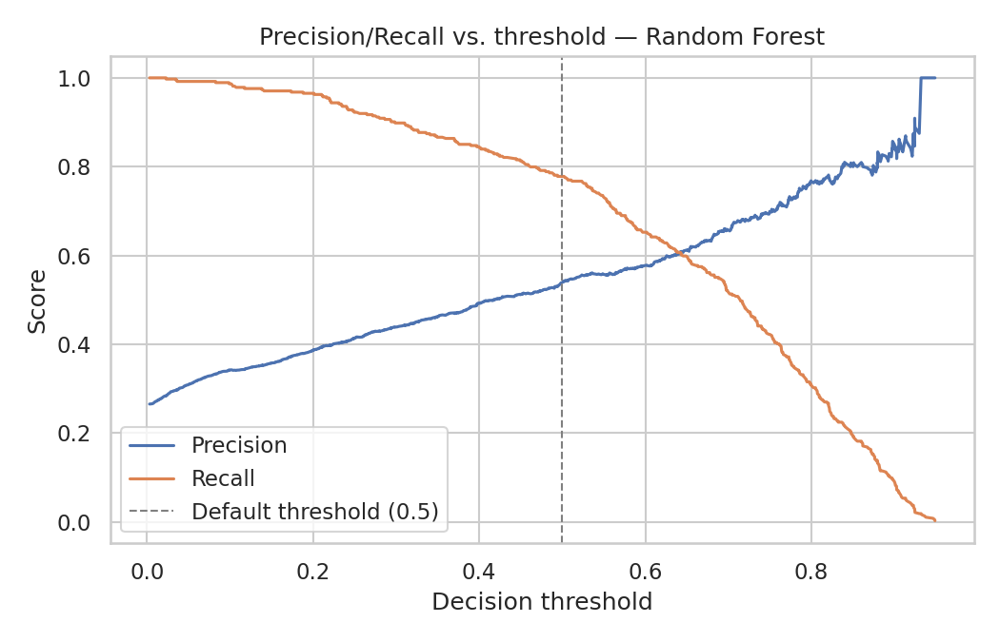

# Telco Customer Churn — End-to-End Machine Learning Project

    

> A churn-risk scoring model for a telecom retention team, built on the public IBM Telco Customer Churn dataset. Author: Hayagriva Boodhoo.

## Contents

1. [Business problem](#business-problem)
2. [Results](#results)
3. [Key insights](#key-insights)
4. [Method](#method)
5. [Charts](#charts)
6. [What this project demonstrates](#what-this-project-demonstrates)
7. [Repository structure](#repository-structure)
8. [How to run](#how-to-run)
9. [Data](#data)
10. [Limitations and future work](#limitations-and-future-work)


## Business problem

A telecom operator's retention team has a limited budget and needs to know, ahead of time, which customers are about to cancel so they can intervene. This project builds and evaluates a churn-risk scoring model for that purpose, with an explicit deployment bar defined up front: **ROC-AUC ≥ 0.75 and churn Recall ≥ 0.65**.

## Results

Final model: **Random Forest tuned with GridSearchCV** (`max_depth=8`, `min_samples_leaf=10`, `n_estimators=200`), evaluated on a held-out 20% test set (1,409 customers) with 95% bootstrap confidence intervals.

| Metric | Score (95% CI) |
|---|---|
| ROC-AUC | 0.844 (0.822–0.865) |
| Recall (churn) | 0.783 (0.739–0.822) |
| Precision (churn) | 0.534 |
| F1 (churn) | 0.635 |
| Accuracy | 0.761 |

A random-guess baseline scores 0.507 ROC-AUC, so the model has learned real signal. The lower bound of each confidence interval clears the deployment bar. Recall and ROC-AUC were prioritised over accuracy because a missed churner costs more than a wasted retention offer.

## Key insights

All figures below come from the exploration section of the notebook.

- **Contract type is the dominant driver.** Month-to-month customers churn at about **42.7%**, against about **2.8%** for two-year contracts, over 9x higher, because they carry no switching cost. The ordering (month-to-month > one-year > two-year) holds **within every internet-service type**, so contract is not just a proxy for internet service.
- **Tenure separates churners best of all numeric features** (correlation with churn about −0.35). New customers churn far more than established ones, which is why `is_new_customer` was engineered as an explicit feature.
- **Churn peaks at one add-on service**, then declines as customers take more. This non-monotonic pattern is why `services_count` was added as a feature instead of relying on six separate one-hot columns.
- **Fibre-optic and electronic-check customers** churn above the base rate (about 26.5% overall).
- **`tenure` and `TotalCharges` are strongly correlated (about 0.83).** This multicollinearity affects how Logistic Regression coefficients should be read, but not Random Forest predictions.
- **Data quality:** the blank `TotalCharges` values all belong to customers with `tenure == 0` (not yet billed), so they were filled with 0.0 and not a median. The IQR outlier check found none.
- **Fairness check:** recall barely differs by gender, but differs more by senior-citizen status. This is flagged to the business as an equity consideration, not hidden.

## Method

```
Raw CSV ─► clean (TotalCharges, SeniorCitizen) ─► engineer features (services_count, is_new_customer)
        ─► stratified 80/20 split ─► ColumnTransformer (one-hot + StandardScaler) ─► model
        ─► 5-fold CV ─► GridSearchCV (Random Forest) ─► test set + bootstrap CIs ─► joblib + predict.py
```

- The split happens **before** any step that learns from data, so there is no leakage from test to train.
- Four models compared with 5-fold cross-validation: Dummy baseline (ROC-AUC about 0.50), Logistic Regression, Decision Tree and Random Forest. Logistic Regression and Random Forest were close; the single tree trailed. Random Forest was tuned.
- Recall on the churn class is the primary metric: with a 73.5% / 26.5% class split, predicting "no churn" for everyone would score about 73.5% accuracy while catching zero churners.

## Charts

| | |
|---|---|
|  |  |
| Churn rate by category: contract type dominates | Correlation heatmap: tenure vs TotalCharges |
|  |  |
| ROC curves: all three models are close (0.834–0.844) | Random Forest feature importance: month-to-month contract and tenure lead |
|  |  |
| Confusion matrices | Decision threshold trade-off |

More charts are in [`figures/`](figures).

## What this project demonstrates

- **Business framing first:** a deployment threshold and a named user of the model, decided before modelling.
- **Leakage-safe pipeline:** train/test split before any fitting; preprocessing and model wrapped together in scikit-learn `Pipeline`s.
- **Model comparison:** dummy baseline, Logistic Regression, Decision Tree and Random Forest, each with 5-fold cross-validation (mean ± std).
- **Honest evaluation:** bootstrap confidence intervals, confusion matrix, three misclassified customers discussed, and a subgroup check (gender, senior citizens) with gaps reported.
- **Deployment readiness:** the trained model saved with `joblib` and a `predict.py` command-line script that scores new customers.

## Repository structure

```
.
├── data/raw/telco_churn.csv                 # IBM Telco Customer Churn (7,043 rows, 21 columns)
├── notebooks/telco_churn_analysis.ipynb     # Full analysis, executed top to bottom
├── figures/                                 # Exported charts
├── report/
│   ├── business_report.pdf                  # 4-page report for a non-technical audience
│   ├── telco_churn_analysis.html            # Browser-viewable export of the notebook
│   ├── model.joblib                         # Trained pipeline (preprocessing + tuned Random Forest)
│   └── predict.py                           # CLI script to score new customers
├── requirements.txt
└── README.md
```

## How to run

```bash
pip install -r requirements.txt
jupyter nbconvert --to notebook --execute --inplace notebooks/telco_churn_analysis.ipynb
```

`RANDOM_STATE = 42` is fixed throughout, so results are reproducible; hyperparameter search results can shift slightly across library versions.

**Score new customers:**

```bash
cd report
python predict.py --input customers.csv --output scored_customers.csv

python predict.py --single \
  --gender Female --SeniorCitizen No --Partner Yes --Dependents No --tenure 5 \
  --PhoneService Yes --MultipleLines No --InternetService "Fiber optic" \
  --OnlineSecurity No --OnlineBackup No --DeviceProtection No --TechSupport No \
  --StreamingTV No --StreamingMovies No --Contract Month-to-month \
  --PaperlessBilling Yes --PaymentMethod "Electronic check" \
  --MonthlyCharges 85.5 --TotalCharges 427.5
```

Run `python predict.py --help` for all options.

> `model.joblib` is a pickle-based file: only load model files from sources you trust.

## Data

**IBM Telco Customer Churn dataset** (public sample data): https://github.com/IBM/telco-customer-churn-on-icp4d — also mirrored on Kaggle. A copy is included so the notebook runs without downloading anything.

## Limitations and future work

- Single public dataset with one snapshot per customer; no time dimension, so the model cannot learn how behaviour changes before churn.
- The model should be retrained and re-checked against the deployment bar on the operator's own data before any real use.
- Next steps: cost-sensitive threshold tuning using real retention costs, SHAP explanations per customer, and a small API wrapper around `predict.py`.
